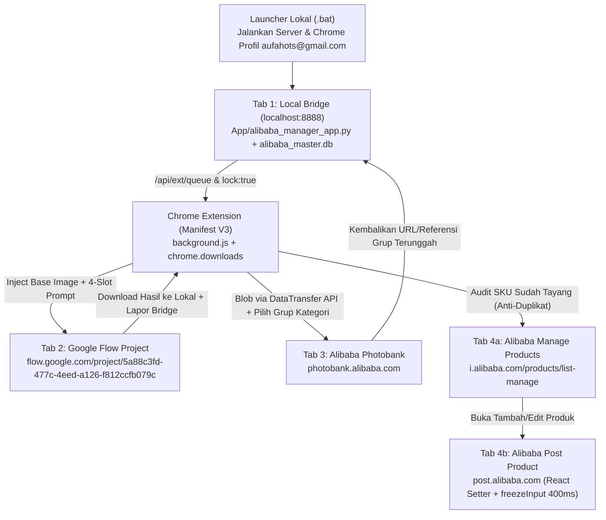

# Relevansi & Pemetaan Arsitektur: Sistem Existing vs. Blueprint Chrome Extension + Google Flow

> **Dokumen Acuan Blueprint:** [`alibaba_auto_fill_ai_flow_blueprint.md`](file:///d:/Work/Hots/Product%20Input/Doc/Alibaba%20Prodcut%20Extetention%20+%20FLow/alibaba_auto_fill_ai_flow_blueprint.md)  
> **Lokasi Folder Dokumen:** [`d:\Work\Hots\Product Input\Doc\Alibaba Prodcut Extetention + FLow`](file:///d:/Work/Hots/Product%20Input/Doc/Alibaba%20Prodcut%20Extetention%20+%20FLow)  
> **Profil Google Chrome Target:** `aufahots@gmail.com`  
> **Target Endpoint Eksternal:**
> 1. **Local Bridge & Web GUI:** `http://localhost:8888` ([`App/alibaba_manager_app.py`](file:///d:/Work/Hots/Product%20Input/App/alibaba_manager_app.py) via [`start.bat`](file:///d:/Work/Hots/Product%20Input/start.bat))
> 2. **Google Flow Project:** `https://flow.google.com/project/5a88c3fd-477c-4eed-a126-f812ccfb079c`
> 3. **Alibaba Photobank:** `https://photobank.alibaba.com/?spm=a2747.$spmCode.0.0.486254bez2VZ2Y`
> 4. **Alibaba Product List & Post:** `https://i.alibaba.com/products/list-manage?spm=a2700.post-success.0.0.290f3e5fVEhelJ#/product/all`

---

## 1. Ringkasan Eksekutif (Executive Summary)

Hasil audit terhadap sistem yang sudah berjalan di workspace `d:\Work\Hots\Product Input` menunjukkan bahwa **~75% fondasi backend, database produk bersih, 4-slot prompt AI, 11 grup folder Photobank, serta server web lokal** sebenarnya **sudah tersedia dan teruji**. Rancangan pada [`alibaba_auto_fill_ai_flow_blueprint.md`](file:///d:/Work/Hots/Product%20Input/Doc/Alibaba%20Prodcut%20Extetention%20+%20FLow/alibaba_auto_fill_ai_flow_blueprint.md) hadir bukan untuk menggantikan sistem yang sudah ada, melainkan untuk melengkapi **25% lapisan eksekusi di dalam browser (*Browser-Native Execution Layer*)** menggunakan **Chrome Extension (Manifest V3)** yang berjalan langsung di profil Chrome aktif **`aufahots@gmail.com`**.

### Mengapa Blueprint Ini Sangat Relevan dengan Sistem Existing?
* **Fondasi Data Sudah Matang (0 Duplikat):** Sistem sudah memiliki **125 Master SKU** (106 AP Boots + 19 Petrova Heavy Duty Safety) pada [`FINAL/master_products_consolidated.db`](file:///d:/Work/Hots/Product%20Input/FINAL/master_products_consolidated.db) dan [`Database/alibaba_master.db`](file:///d:/Work/Hots/Product%20Input/Database/alibaba_master.db), lengkap dengan 57 kolom standar ekspor Alibaba di [`FINAL/master_products_complete_detailed.xlsx`](file:///d:/Work/Hots/Product%20Input/FINAL/master_products_complete_detailed.xlsx).
* **Masalah *Upload* Alibaba & *Photobank* Terjawab:** Selama ini, unggah Excel *bulk* di Seller Center Alibaba sering mengalami *reset* otomatis pada harga/MOQ saat halaman memuat AJAX kategori, serta mengharuskan pemilahan foto manual ke folder grup di **Alibaba Photobank** (`photobank.alibaba.com`). Melalui ekstensi Chrome pada profil `aufahots@gmail.com`, file foto lokal dan data terkunci (*DOM Freeze*) dapat disuntikkan langsung memakai sesi login asli browser tanpa risiko blokir *headless browser* atau CAPTCHA.
* **Penyatuan Jalur Google Flow:** Project Google Flow (`5a88c3fd-477c-4eed-a126-f812ccfb079c`) dan payload 4-slot B2B sudah tercatat di [`App/photobank_api_bridge.py`](file:///d:/Work/Hots/Product%20Input/App/photobank_api_bridge.py) serta [`Output/flow_product_input_jobs.json`](file:///d:/Work/Hots/Product%20Input/Output/flow_product_input_jobs.json) (424 *jobs*). Ekstensi Chrome menjadikan alur *upload reference image → generate 4 variasi → auto-download* berjalan mulus secara lokal di satu profil Chrome.

---

## 2. Matriks Relevansi: Blueprint vs. Sistem yang Sudah Ada (*Existing System*)

Tabel berikut memetakan setiap komponen teknis pada [`alibaba_auto_fill_ai_flow_blueprint.md`](file:///d:/Work/Hots/Product%20Input/Doc/Alibaba%20Prodcut%20Extetention%20+%20FLow/alibaba_auto_fill_ai_flow_blueprint.md) terhadap aset dan modul yang telah ada di workspace:

| Komponen di Blueprint | Spesifikasi di `alibaba_auto_fill_ai_flow_blueprint.md` | Aset / Modul Existing di Workspace | Status Kesiapan & Strategi Integrasi |
| :--- | :--- | :--- | :--- |
| **Dataset Master** | File `produk_alibaba.xlsx` (`Product_Name`, `Keyword_1..3`, `MOQ`, `Price_Min/Max`, `Photobank_Group`, `Status`) | • [`Database/alibaba_master.db`](file:///d:/Work/Hots/Product%20Input/Database/alibaba_master.db) (tabel `master_products` 125 baris & `products` 802 baris) • [`FINAL/master_products_consolidated.db`](file:///d:/Work/Hots/Product%20Input/FINAL/master_products_consolidated.db) • [`FINAL/master_products_complete_detailed.xlsx`](file:///d:/Work/Hots/Product%20Input/FINAL/master_products_complete_detailed.xlsx) | **✅ 100% Tersedia.** Tidak perlu membuat Excel mentah dari nol; Python Bridge cukup membaca langsung dari `alibaba_master.db` (125 SKU Master + 57 kolom Alibaba + harga tier FOB USD). |
| **Python Local Bridge** | Server lokal Flask (`127.0.0.1:5000`) dengan CORS untuk `*.alibaba.com`, endpoint JSON produk (`lock: true`), dan stream gambar | • [`App/alibaba_manager_app.py`](file:///d:/Work/Hots/Product%20Input/App/alibaba_manager_app.py) (`http://localhost:8888`, dijalankan oleh [`start.bat`](file:///d:/Work/Hots/Product%20Input/start.bat)) • [`FINAL/server_final.py`](file:///d:/Work/Hots/Product%20Input/FINAL/server_final.py) (`http://localhost:8899`) | **🟡 85% Siap.** Kedua server sudah memiliki header CORS (`Access-Control-Allow-Origin: *`) dan *routing* gambar lokal (`/assets/shopee/`, `/assets/tokopedia/`, `/assets/photobank/`). Cukup tambahkan namespace endpoint `/api/ext/*` di `alibaba_manager_app.py` (dan/atau *listener* alias port jika dibutuhkan) agar tidak perlu membangun server baru yang terpisah. |
| **Aset Foto Lokal & Grup Photobank** | Membaca gambar lokal ke *Blob* (`DataTransfer`) dan memilih grup `Photobank_Group` | • [`Output/Photobank_Siap_Upload`](file:///d:/Work/Hots/Product%20Input/Output/Photobank_Siap_Upload) (**517 file `.webp`** dalam **11 folder kategori resmi**) • [`DAFTAR_FOTO_DAN_KATEGORI_PHOTOBANK.csv`](file:///d:/Work/Hots/Product%20Input/Output/Photobank_Siap_Upload/DAFTAR_FOTO_DAN_KATEGORI_PHOTOBANK.csv) • [`Shopee_Product_Assets`](file:///d:/Work/Hots/Product%20Input/Shopee_Product_Assets) (**124 folder**) • [`Images_Tokopedia`](file:///d:/Work/Hots/Product%20Input/Images_Tokopedia) (**468 foto lokal 1600×1600**) | **✅ 100% Tersedia.** Ke-11 folder kategori lokal dipetakan langsung ke nama folder/grup di `https://photobank.alibaba.com/?spm=a2747.$spmCode.0.0.486254bez2VZ2Y`. |
| **Google Flow Visual Generator (Phase 2)** | Otomasi tab `flow.google`: upload *base image*, isi prompt, generate, dan deteksi download via `chrome.downloads.onChanged` | • [`App/photobank_api_bridge.py`](file:///d:/Work/Hots/Product%20Input/App/photobank_api_bridge.py) (mengunci `FLOW_PROJECT_ID = 5a88c3fd-477c-4eed-a126-f812ccfb079c`, akun `aufahots@gmail.com`) • [`Output/flow_product_input_jobs.json`](file:///d:/Work/Hots/Product%20Input/Output/flow_product_input_jobs.json) (**424 jobs**) • [`buka_flow_10_batch.bat`](file:///d:/Work/Hots/Product%20Input/buka_flow_10_batch.bat) | **🟡 80% Siap.** Prompt 4-slot B2B dan *job queue* JSON sudah ada. Tinggal menambahkan **Content Script** (`content_flow.js`) dan **Background Downloader** (`background.js`) di Chrome Extension. |
| **DOM Auto-Fill, List Checker & Freeze (Phase 1)** | Suntik React Input Setter (`HTMLInputElement.prototype.value`), *MutationObserver* atribut dinamis, `freezeInput()` setiap `400ms` (border biru), dan panel overlay kontrol | • Belum ada di workspace (masih sebatas ekspor Excel 57 kolom dan API docs di [`App/template.html`](file:///d:/Work/Hots/Product%20Input/App/template.html)) | **🔴 0% (Target Utama Pembangunan Baru).** Komponen murni baru di Chrome Extension (`content_alibaba_list.js` dan `content_alibaba_post.js`) untuk membaca `i.alibaba.com/products/list-manage` serta mengisi & mengunci form di `post.alibaba.com`. |

---

## 3. Alur Kerja Terpadu 4 URL & Profil Chrome (`aufahots@gmail.com`)

Seluruh otomasi dijalankan di dalam **1 profil Google Chrome yang sudah login ke akun Google `aufahots@gmail.com` serta akun Seller Center My Alibaba**. Pendekatan *browser-native* ini menghindari proteksi anti-bot dan memusatkan orkestrasi antar 4 tab utama.

### Peran Teknis Masing-Masing Titik Akses:

1. **Tab 1 — Python Local Bridge & Web GUI (`http://localhost:8888`)**
   * Dijalankan oleh [`App/alibaba_manager_app.py`](file:///d:/Work/Hots/Product%20Input/App/alibaba_manager_app.py) (`start.bat`).
   * Bertindak sebagai *Single Source of Truth* untuk Chrome Extension: menyediakan daftar antrean SKU (`GET /api/ext/products`), detail per SKU lengkap dengan flag `lock: true` pada harga FOB & MOQ, stream gambar biner lokal (`/assets/tokopedia/...`, `/assets/shopee/...`, `/assets/photobank/...`) agar ekstensi dapat mengubahnya menjadi objek `File`/`Blob`, serta menerima pembaruan status (`POST /api/ext/status`) setelah produk diproses.

2. **Tab 2 — Google Flow Project (`https://flow.google.com/project/5a88c3fd-477c-4eed-a126-f812ccfb079c`)**
   * Berjalan di atas akun **`aufahots@gmail.com`** agar langsung mengakses kuota & *workspace* project yang tepat.
   * `content_flow.js` membaca pekerjaan dari [`Output/flow_product_input_jobs.json`](file:///d:/Work/Hots/Product%20Input/Output/flow_product_input_jobs.json) / `/api/ext/flow-jobs`, mengunggah foto referensi produk lokal (`hero_*.webp` atau foto Tokopedia 1600×1600), mengisi 4 prompt standar (*Slot 1 Hero White BG*, *Slot 2 Lateral Profile 90°*, *Slot 3 Outsole Tread*, *Slot 4 Contextual In-Use*), memantau status *rendering* di DOM, dan memicu unduhan.
   * `background.js` menggunakan listener `chrome.downloads.onChanged` untuk memindahkan/mendaftarkan gambar baru agar siap masuk ke Photobank dan database lokal.

3. **Tab 3 — Alibaba Photobank (`https://photobank.alibaba.com/?spm=a2747.$spmCode.0.0.486254bez2VZ2Y`)**
   * `content_photobank.js` membaca properti `Photobank_Group` (misalnya `01_Safety_Boots`, `02_Terra_Series`, dst. dari 11 kategori resmi).
   * Secara otomatis membuka/memilih grup folder tujuan di pohon folder Photobank Alibaba, lalu mengambil file gambar dari `http://localhost:8888/assets/...` via `fetch()`, membungkusnya dengan **`DataTransfer` API**, dan menyuntikkannya ke `<input type="file">` milik modal unggah Photobank sehingga nama file tetap bersih ber-prefix SKU (`APB-016_...webp` / `MST-001_...`).

4. **Tab 4 — Alibaba Product List & Auto-Fill/Freeze**
   * **Halaman List Produk (`https://i.alibaba.com/products/list-manage?spm=a2700.post-success.0.0.290f3e5fVEhelJ#/product/all`):**
     * `content_alibaba_list.js` melakukan pemindaian (*DOM audit*) terhadap produk yang sudah tayang di akun Seller Center (judul, `alibaba_product_id`, model number, harga, dan status), lalu mengirim hasil sinkronisasi ke Local Bridge (`alibaba_master.db`) untuk menandai mana SKU dari 125 Master SKU yang sudah live dan mana yang masih `PENDING` (mencegah duplikasi).
     * Menyediakan tombol injeksi cepat di panel mengambang (*Floating Overlay*) untuk membuka form edit/tambah produk.
   * **Halaman Post/Edit Produk (`post.alibaba.com`):**
     * `content_alibaba_post.js` mengisi kolom React menggunakan native setter `HTMLInputElement.prototype.value` + `Event('input', { bubbles: true })`, menangani *dynamic category attributes* lewat `MutationObserver`, memilih gambar dari grup Photobank yang baru saja diunggah pada Langkah 3, dan mengaktifkan **`freezeInput()` (interval `400ms` dengan indikator border biru `#2563eb`)** pada `MOQ`, `Price_Min`, `Price_Max`, serta atribut kritis agar nilai tidak ter-reset ketika skrip AJAX Alibaba memuat ulang form.

---

## 4. Pemetaan Skema Kolom Blueprint ke Database Existing

Agar Chrome Extension dapat bekerja langsung dengan data yang sudah matang tanpa membuat file Excel terpisah, berikut adalah pemetaan kolom dari Tabel Seksi 4 di [`alibaba_auto_fill_ai_flow_blueprint.md`](file:///d:/Work/Hots/Product%20Input/Doc/Alibaba%20Prodcut%20Extetention%20+%20FLow/alibaba_auto_fill_ai_flow_blueprint.md) ke kolom nyata di [`Database/alibaba_master.db`](file:///d:/Work/Hots/Product%20Input/Database/alibaba_master.db) dan [`Output/flow_product_input_jobs.json`](file:///d:/Work/Hots/Product%20Input/Output/flow_product_input_jobs.json):

| Kolom di Blueprint | Tipe | Sumber Kolom di `alibaba_master.db` / JSON Existing | Logika Transformasi Bridge (`/api/ext/product/<sku>`) |
| :--- | :--- | :--- | :--- |
| `Product_Name` | String | `products.product_title` / `master_products.english_title` | Maksimal 128 karakter formula B2B Accio; dikirim dengan flag `lock: true`. |
| `Keyword_1` | String | `products.target_keywords` / `products.keywords` (token ke-1) | Diambil dari pemisahan koma/newline keyword pertama, fallback ke `master_products.seo_keywords`. |
| `Keyword_2` | String | `products.target_keywords` / `products.keywords` (token ke-2) | Keyword B2B sekunder. |
| `Keyword_3` | String | `products.target_keywords` / `products.keywords` (token ke-3) | Keyword *long-tail* / aplikasi sektor. |
| `Category_Path` | String | `products.category` + `master_products.category_name` | Dipetakan ke *taxonomy path* Alibaba (misal: `Shoes & Accessories > Men's Shoes > Boots` / `Security & Protection > Safety Footwear`). |
| `MOQ` | Integer | `products.moq1` / `master_products.pairs_per_carton` / `master_products.moq_pairs` | Dikirim sebagai angka integer terkunci (`lock: true`) untuk `freezeInput()`. |
| `Price_Min` | Float | `products.tier3_price` atau `products.price_usd` (`master_products.price_fob_usd`) | Harga FOB USD terendah pada tier tertinggi; dikunci dengan `lock: true`. |
| `Price_Max` | Float | `products.tier1_price` atau `products.price_usd` (`master_products.price_fob_usd`) | Harga FOB USD tier awal/satuan; dikunci dengan `lock: true`. |
| `Photobank_Group` | String | `master_products.category_name` via pemetaan di [`category_mapper.py`](file:///d:/Work/Hots/Product%20Input/App/flow_photobank/category_mapper.py) | Menghasilkan 11 nama grup resmi (`01_Safety_Boots` s/d `11_General_Lifestyle_Boots`) sesuai folder di [`Output/Photobank_Siap_Upload`](file:///d:/Work/Hots/Product%20Input/Output/Photobank_Siap_Upload). |
| `Image_Filename` | String | `products.image_1..image_6` / `product_reference_images.image_url` | URL stream lokal `http://localhost:8888/assets/...` (prioritas: Photobank 4-Slot → Shopee WebP → Tokopedia Lokal 1600×1600). |
| `Flow_Prompt` | String | [`Output/flow_product_input_jobs.json`](file:///d:/Work/Hots/Product%20Input/Output/flow_product_input_jobs.json) (`prompt` / `flow_payload`) | Mengambil array 4 prompt per SKU (`slot_1_hero`, `slot_2_side`, `slot_3_tread`, `slot_4_contextual`). |
| `Status` | String | `products.status` + `products.alibaba_product_id` | Menggabungkan status DB (`PENDING` / `APPROVED` / `DONE`) serta mencatat `alibaba_product_id` hasil sinkronisasi `list-manage`. |

### Pemetaan Kategori Existing ke Grup Folder Alibaba Photobank:
Berikut adalah 11 folder kategori resmi yang sudah tersedia di [`Output/Photobank_Siap_Upload`](file:///d:/Work/Hots/Product%20Input/Output/Photobank_Siap_Upload) dan akan dijadikan nama `Photobank_Group` target di `photobank.alibaba.com`:

| ID Kategori | Folder Lokal & `Photobank_Group` | Produk / Seri yang Tercakup | Jumlah Aset `.webp` Saat Ini |
| :--- | :--- | :--- | :--- |
| 1 | `01_Safety_Boots` | AP Max, AP Metaguard, S4/S5, & 19 SKU Petrova Safety | 19+ file |
| 2 | `02_Terra_Series` | AP Terra 1, Terra 2, Terra 3, Terra 5, Eco 2/3/5, Terra GP, Terra Army/Forest | 39+ file |
| 3 | `03_Orca_Series` | AP Boots ORCA Industrial & Marine | 8+ file |
| 4 | `04_Chef_Series` | AP Chef Putih, AP Chef Hitam, Footbed Sol AP Chef | 16+ file |
| 5 | `05_Medic_Series` | AP Medic (Biru, Hijau, Hitam, Pink, Putih) & Footbed Medic | 4+ file |
| 6 | `06_Biker_Casual` | AP Allbike, Allbike 2, AP Moto 1/2/3, Hobby N Work | 19+ file |
| 7 | `07_Classic_Boots` | AP 1, AP 2003, 2005, 2006, 2007, 2011, 2015, 2017, 2018, 9303, 9506, XTR | 23+ file |
| 8 | `08_Kids_Boots` | AP Kids 2012 Series & AP Kids Safari (Crocodile, Elephant, Zebra) | 6+ file |
| 9 | `09_Sandals_Clogs` | AP Clogs & Sandal Selop (989, 991, 995, 999, 1001) | 13+ file |
| 10 | `10_Kasual_Sneakers` | AP Star & Sepatu Bola PVC (963, 967, 969, 977) | 6+ file |
| 11 | `11_General_Lifestyle_Boots` | Aset umum konstruksi, perkebunan, & foto lifestyle kontekstual | 263+ file |

---

## 5. Mekanisme Penautan Profil Chrome `aufahots@gmail.com` & Launcher Lokal (`.bat`)

Agar ekstensi selalu aktif pada akun **`aufahots@gmail.com`** (yang sudah login ke Google Flow project `5a88c3fd-477c-4eed-a126-f812ccfb079c`, Alibaba Photobank, dan Seller Center My Alibaba) dan berjalan rapi secara lokal di Windows:

1. **Deteksi Otomatis Profil Chrome `aufahots@gmail.com` (`Local State`):**
   * Google Chrome menyimpan pemetaan akun email ke nama folder profil (seperti `Default`, `Profile 1`, `Profile 2`, dst.) di berkas JSON:  
     `%LOCALAPPDATA%\Google\Chrome\User Data\Local State` pada key `profile.info_cache.<folder>.user_name`.
   * Pada tahap eksekusi nanti, skrip launcher lokal (`.bat` / helper Python) akan membaca `Local State` secara otomatis untuk menemukan `--profile-directory` yang memiliki `user_name == "aufahots@gmail.com"`, sehingga operator tidak pernah salah membuka profil Chrome pribadi lain.
   * Sebagai alternatif keamanan apabila profil utama sedang terkunci oleh jendela Chrome lain yang sudah terbuka, launcher dapat memeriksa apakah profil tersebut bisa langsung membuka tab baru atau menggunakan `--user-data-dir` / profil terpasang.

2. **Pemuatan Ekstensi Secara Lokal & Pembukaan 4 Tab Kerja:**
   * Launcher lokal menjalankan `App/alibaba_manager_app.py` (`http://localhost:8888`) di latar belakang atau jendela konsol tersendiri.
   * Selanjutnya Chrome diluncurkan menuju profil `aufahots@gmail.com` dengan flag pemuatan ekstensi lokal (atau membuka ekstensi yang sudah di-*load unpacked* via Developer Mode di `chrome://extensions/`), lalu otomatis membuka 4 URL kerja:
     1. `http://localhost:8888`
     2. `https://flow.google.com/project/5a88c3fd-477c-4eed-a126-f812ccfb079c`
     3. `https://photobank.alibaba.com/?spm=a2747.$spmCode.0.0.486254bez2VZ2Y`
     4. `https://i.alibaba.com/products/list-manage?spm=a2700.post-success.0.0.290f3e5fVEhelJ#/product/all`

3. **Sinkronisasi Unduhan Google Flow ke Folder Workspace:**
   * Dengan `chrome.downloads.onDeterminingFilename` / `chrome.downloads.onChanged` di `background.js`, gambar yang dihasilkan Google Flow diberi penanda SKU & slot (misal `HOTS_FLOW_MST-001_slot_1_hero.webp`), lalu dijemput/dipindahkan ke [`Output/Photobank_Siap_Upload`](file:///d:/Work/Hots/Product%20Input/Output/Photobank_Siap_Upload) atau [`Shopee_Product_Assets`](file:///d:/Work/Hots/Product%20Input/Shopee_Product_Assets) oleh Local Bridge agar langsung tersedia di `/assets/...` untuk tahap unggah ke Alibaba Photobank.

---

## 6. Daftar Komponen Baru yang Akan Dibangun pada Tahap Eksekusi (*Next Steps*)

Setelah dokumen relevansi ini disetujui, implementasi teknis dibagi menjadi 3 bagian terukur yang langsung menempel ke sistem existing tanpa merusak fitur Web GUI yang sudah berjalan:

### A. Penambahan Endpoint Extension Bridge di [`App/alibaba_manager_app.py`](file:///d:/Work/Hots/Product%20Input/App/alibaba_manager_app.py)
* `GET /api/ext/queue`: Daftar antrean 125 Master SKU beserta filter status (`PENDING`, `APPROVED`, `LIVE_ALIBABA`).
* `GET /api/ext/product/<sku>`: Mengembalikan payload lengkap format blueprint (`Product_Name`, `Keyword_1..3`, `MOQ`, `Price_Min`, `Price_Max`, `Photobank_Group`, daftar URL gambar lokal, atribut dinamis, dan `lock: true`).
* `GET /api/ext/flow-jobs/<sku>`: Mengembalikan 4-slot prompt + path foto referensi lokal dari [`Output/flow_product_input_jobs.json`](file:///d:/Work/Hots/Product%20Input/Output/flow_product_input_jobs.json).
* `POST /api/ext/sync-alibaba-list`: Menerima hasil *scraping* DOM dari halaman `i.alibaba.com/products/list-manage` untuk memperbarui `alibaba_product_id` dan status tayang di `Database/alibaba_master.db`.
* `POST /api/ext/flow-downloaded`: Memproses hasil unduhan Google Flow dari folder Downloads Chrome ke folder `Photobank_Siap_Upload/<Photobank_Group>/` dan mengonversinya ke WebP 1000×1000.

### B. Paket Chrome Extension (Manifest V3) — Folder Baru `Chrome_Extension/`
* `Chrome_Extension/manifest.json`: Izin `activeTab`, `tabs`, `storage`, `downloads`, serta `host_permissions` untuk `http://localhost:8888/*`, `http://127.0.0.1:8888/*`, `https://*.alibaba.com/*`, dan `https://flow.google.com/*`.
* `Chrome_Extension/background.js`: Service worker pengatur koordinasi antar-tab (Local Bridge ↔ Google Flow ↔ Alibaba Photobank ↔ Alibaba List/Post) dan pemantau `chrome.downloads.onChanged`.
* `Chrome_Extension/popup.html` & `popup.js`: Kontrol cepat untuk melihat status koneksi Local Bridge (`:8888`), memilih SKU / antrean, dan tombol aksi cepat per tab.
* `Chrome_Extension/content_flow.js`: Otomasi DOM di `https://flow.google.com/project/5a88c3fd-477c-4eed-a126-f812ccfb079c` (unggah base image, isi 4 prompt, tunggu selesai render, klik download).
* `Chrome_Extension/content_photobank.js`: Otomasi DOM di `https://photobank.alibaba.com/*` (pilih/buat folder sesuai `Photobank_Group`, suntik gambar lokal via `DataTransfer` API ke `<input type="file">`).
* `Chrome_Extension/content_alibaba_list.js`: Pembacaan daftar produk eksisting di `https://i.alibaba.com/products/list-manage*` untuk sinkronisasi anti-duplikat ke DB lokal + overlay tombol "Auto-Fill SKU".
* `Chrome_Extension/content_alibaba_post.js`: Pengisi form di `post.alibaba.com` dengan React Input Setter (`HTMLInputElement.prototype.value`), `MutationObserver` untuk *dynamic attributes*, dan `freezeInput()` tiap `400ms` (indikator border biru `#2563eb`).

### C. Launcher Lokal Terpadu (`.bat`)
* `run_alibaba_extension_flow.bat` (di root workspace):
  1. Memeriksa dan menjalankan server lokal [`App/alibaba_manager_app.py`](file:///d:/Work/Hots/Product%20Input/App/alibaba_manager_app.py) di port `8888`.
  2. Mendeteksi folder `--profile-directory` milik akun `aufahots@gmail.com` dari Chrome `Local State`.
  3. Membuka Google Chrome pada profil tersebut dengan seluruh URL kerja (Localhost, Google Flow Project, Alibaba Photobank, dan Alibaba Manage Products) siap dijalankan berdampingan.
