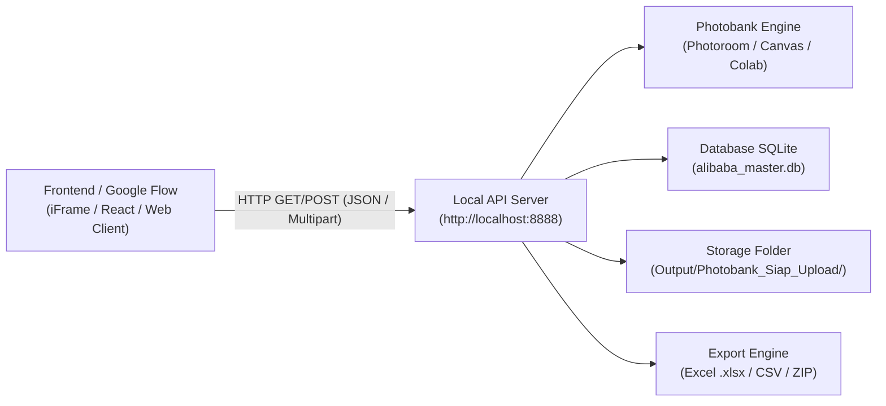

# 🔌 Panduan Setup & Dokumentasi REST API Website
## AP BOOTS® Global B2B Catalog Manager & Photobank Service

> **Lokasi Dokumen:** `Doc/PANDUAN_SETUP_DAN_DOKUMENTASI_WEBSITE_API.md`  
> **Base URL Lokal:** `http://localhost:8888`  
> **Interactive API Portal:** `http://localhost:8888/api/docs` atau `http://localhost:8888/api`  
> **OpenAPI 3.0 Schema:** `http://localhost:8888/api/openapi.json`  
> **Target Production:** `https://admin.hotstrading.com`

---

## 📌 1. Ikhtisar & Arsitektur API

Server lokal aplikasi dijalankan via [`start.bat`](file:///d:/Work/Hots/Product%20Input/start.bat) dan menyediakan layanan **REST API lengkap** dengan dukungan CORS penuh (`Access-Control-Allow-Origin: *`). Ini memungkinkan antarmuka web, script luar, dan aplikasi sandbox frontend (seperti **Google Flow Agentic Tool**) memanggil endpoint katalog dan engine gambar tanpa hambatan keamanan.



---

## 🚀 2. Cara Mengakses & Menguji API

### A. Menggunakan Interactive Web API Explorer
1. Pastikan server aktif (jalankan [`start.bat`](file:///d:/Work/Hots/Product%20Input/start.bat)).
2. Buka peramban dan akses:
   👉 **`http://localhost:8888/api/docs`**
3. Anda dapat:
   - Melihat daftar seluruh endpoint yang dikelompokkan per kategori.
   - Mengklik tombol **"⚡ Jalankan Test"** pada masing-masing kartu untuk melihat respon data JSON secara langsung.
   - Menguji koneksi dengan tombol **"🧪 Test Live Ping"**.

### B. Import ke Postman / Insomnia
- Import spesifikasi OpenAPI 3.0 langsung dari URL:  
  `http://localhost:8888/api/openapi.json`

---

## 📋 3. Katalog Endpoint Utama

### Kategori A: Photobank & Image Generation

#### 1. Generate Variasi Gambar Custom (Photoroom / Colab / Smart Canvas)
- **Endpoint:** `POST /api/photobank/custom-generate`
- **Headers:** `Content-Type: application/json`
- **Request Body:**
```json
{
  "sku": "SHP-001",
  "folder": "AP_Boots_XTR_Hitam_Sepatu_Boot_PVC",
  "slots": [1, 2],
  "target_size": 1000,
  "fill_ratio": 0.85,
  "save_to_shopee": true,
  "save_to_flow": true,
  "save_to_photobank": true,
  "engine": "openai_dalle",
  "api_key": "sk-proj-wSB7HKwqNTJKg9sfBt65...",
  "ngrok_url": "https://xxxx.ngrok-free.app/generate-background/"
}
```

> **Pilihan Nilai `engine` yang Didukung:**
> 1. `"openai_dalle"`: Menggunakan **OpenAI DALL-E 3** resolusi 1024×1024 (Kualitas visual studio & contextual terbaik). API key tersimpan di [`Doc/OPENAI_API_KEY.txt`](file:///d:/Work/Hots/Product%20Input/Doc/OPENAI_API_KEY.txt).
> 2. `"photoroom"`: Segmentasi latar putih seamless & shadow studio profesional via Photoroom API.
> 3. `"smart_canvas"`: Generator canvas Python native lokal (100% gratis, tanpa kuota/API key).
> 4. `"google_ai_studio"`: Imagen AI via Google AI Studio API.
> 5. `"colab_diffusers"`: Stable Diffusion Inpainting via Google Colab tunnel ngrok.
```
- **Response Berhasil (HTTP 200):**
```json
{
  "success": true,
  "sku": "SHP-001",
  "product_name": "AP Boots XTR Hitam Sepatu Boot PVC",
  "category_folder": "07_Classic_Boots",
  "variations_generated": [
    {
      "slot": 1,
      "type": "hero_white_bg",
      "filename": "SHP_001_AP_Boots_XTR_Hitam_Sepatu_slot_1_hero.webp",
      "ai_generated": true
    },
    {
      "slot": 2,
      "type": "side_profile_90deg",
      "filename": "SHP_001_AP_Boots_XTR_Hitam_Sepatu_slot_2_side.webp",
      "ai_generated": true
    }
  ]
}
```

---

#### 2. Ingest Receiver Upload Foto ke Photobank (Direct Upload)
- **Endpoint:** `POST /api/photobank/upload`
- **Fungsi:** Menerima unggahan foto langsung (format Base64 JSON atau Multipart form-data), menyimpan ke folder kategori Photobank, dan mencatatnya ke `manifest_photobank.csv`.
- **Request Body (JSON Base64):**
```json
{
  "sku": "SHP-001",
  "folder": "AP_Boots_XTR_Hitam_Sepatu_Boot_PVC",
  "slot": "slot_1_hero",
  "category": "07_Classic_Boots",
  "image_base64": "data:image/webp;base64,UklGR..."
}
```
- **Response Berhasil (HTTP 200):**
```json
{
  "success": true,
  "sku": "SHP-001",
  "folder_name": "AP_Boots_XTR_Hitam_Sepatu_Boot_PVC",
  "slot": "slot_1_hero",
  "label": "Hero White BG 1:1",
  "filename": "SHP_001_AP_Boots_XTR_Hitam_Sepatu_slot_1_hero.webp",
  "category_folder": "07_Classic_Boots",
  "path": "d:\\Work\\Hots\\Product Input\\Output\\Photobank_Siap_Upload\\07_Classic_Boots\\...",
  "file_size_kb": 24.5
}
```

---

#### 3. Cek Status Kesiapan Folder Photobank
- **Endpoint:** `GET /api/photobank/status`
- **Response Berhasil (HTTP 200):**
```json
{
  "success": true,
  "total_photobank_files": 48,
  "manifest_entries": 48,
  "categories": {
    "01_Safety_Boots": { "count": 8, "group_name": "Safety Boots" },
    "07_Classic_Boots": { "count": 16, "group_name": "Classic Rain Boots" }
  }
}
```

---

### Kategori B: Katalog Produk & Shopee Assets

#### 1. Ambil 123 Produk Resmi Shopee Official
- **Endpoint:** `GET /api/shopee/products`
- **Fungsi:** Mengambil metadata 104 AP Boots + 19 Petrova, ketersediaan file hero local WEBP, status JSON B2B, dan harga IDR.

#### 2. Ambil Master Database Produk dengan Filter
- **Endpoint:** `GET /api/products?is_flagship=1&source=all&search=terra`
- **Parameter Query:**
  - `is_flagship`: `1` (Flagship 40 produk) atau `0`
  - `source`: `shopee`, `tokopedia`, `lazada`, `blibli`, atau `all`
  - `search`: kata kunci nama produk atau SKU

---

### Kategori C: Live Forex & Logistik Kontainer

#### 1. Kurs Real-Time Google Forex USD / IDR
- **Endpoint:** `GET /api/exchange_rate`
- **Response:**
```json
{
  "success": true,
  "usd_idr_rate": 16250.0,
  "source": "Google Live Forex Engine",
  "updated_at": "2026-11-03 11:20:00"
}
```

#### 2. Kalkulator Kemasan Karton & Muatan Kontainer
- **Endpoint:** `GET /api/calculate_carton?usd=5.50&pairs=12&category=Safety%20Boots`
- **Response:**
```json
{
  "success": true,
  "data": {
    "carton_dimensions_cm": { "length": 60.0, "width": 42.0, "height": 38.0 },
    "cbm_per_carton": 0.09576,
    "gross_weight_kg": 20.4,
    "container_20ft_capacity": { "cartons": 344, "total_pairs": 4128 },
    "container_40ft_hq_capacity": { "cartons": 793, "total_pairs": 9516 }
  }
}
```

---

### Kategori D: Google Flow & Export Center

#### 1. Generate Coupled JSON 10 Produk untuk Flow Agent
- **Endpoint:** `GET /api/flow/bundle-10-products?folders=AP_Boots_XTR_...,AP_Boots_AP_1_...`
- **Fungsi:** Menghasilkan payload coupled JSON 10 produk dan prompt master untuk `https://flow.google.com/project/5a88c3fd-477c-4eed-a126-f812ccfb079c`.

#### 2. Export ke Excel (.xlsx) / CSV
- **Endpoint:** `POST /api/export`
- **Request Body:**
```json
{
  "target": "flagship_40",
  "format": "xlsx",
  "regenerate_keywords": true,
  "keyword_mode": "accio"
}
```
- **Response:**
```json
{
  "success": true,
  "count": 40,
  "filename": "Alibaba_Bulk_Upload_October_2026_40_Flagship.xlsx",
  "download_url": "/api/download/Alibaba_Bulk_Upload_October_2026_40_Flagship.xlsx"
}
```

---

## 💻 4. Contoh Kode Pemanggilan (Code Snippets)

### Contoh A: JavaScript / Fetch (Digunakan di Google Flow Tool atau Web Frontend)
```javascript
// Panggil API Generate Photoroom untuk 1 Produk
async function generateProductStudio(sku, folderName) {
    const response = await fetch('http://localhost:8888/api/photobank/custom-generate', {
        method: 'POST',
        headers: { 'Content-Type': 'application/json' },
        body: JSON.stringify({
            sku: sku,
            folder: folderName,
            slots: [1, 2], // Slot 1 Hero + Slot 2 Side
            target_size: 1000,
            fill_ratio: 0.85,
            engine: 'photoroom',
            api_key: 'sk_pr_default_5cf2ec3a5a6ce7e52ab8dcfa7b50d2dbca4dd651'
        })
    });
    const result = await response.json();
    console.log('Hasil Generasi:', result);
    return result;
}
```

### Contoh B: Python `requests`
```python
import requests

url = "http://localhost:8888/api/photobank/upload"
payload = {
    "sku": "SHP-001",
    "folder": "AP_Boots_XTR_Hitam_Sepatu_Boot_PVC",
    "slot": "slot_1_hero",
    "category": "07_Classic_Boots",
    "image_base64": "data:image/webp;base64,UklGRkAAAABXRUJQVlA4..."
}

res = requests.post(url, json=payload)
print(res.status_code, res.json())
```

### Contoh C: cURL (Terminal Windows / Linux)
```bash
curl -X GET "http://localhost:8888/api/exchange_rate" -H "Accept: application/json"
```

---

## 🛠️ 5. Menjalankan Server API
Jalankan file batch utama:
```cmd
start.bat
```
Server akan aktif di `http://localhost:8888`. Anda dapat mengakses portal dokumentasi interaktif kapan saja di:
👉 **`http://localhost:8888/api/docs`**
