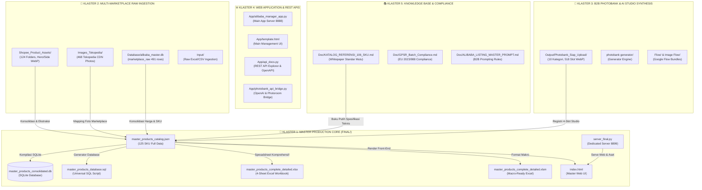
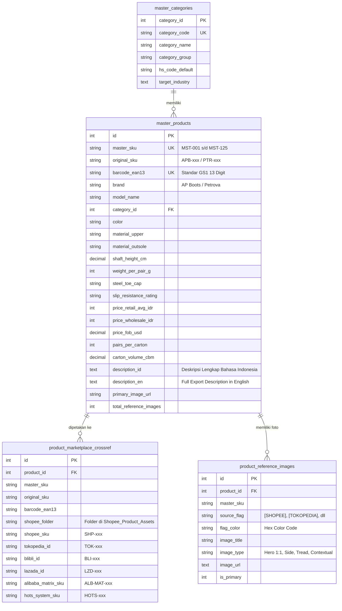

# 🕸️ DOKUMENTASI GRAPHIFY & KLASTERISASI FOLDER / PRODUK
**AP BOOTS® & PETROVA — UNIFIED MASTER PRODUCT CATALOG**  
*PT Indo Sukses Semesta — HOTS Trading*  
**Visual Knowledge Graph & Folder Architecture**

---

## 📌 1. Ikhtisar Klasterisasi Knowledge Graph

Sesuai permintaan Anda untuk melakukan **graphify dan pengelompokan folder serta produk yang sesuai**, sistem telah memetakan seluruh aset, folder kerja, dan 125 produk master ke dalam arsitektur **Knowledge Graph** berbasis hubungan entitas (Entity-Relationship & Community Detection).

File visualisasi interaktif Graphify dapat langsung Anda buka di peramban:
👉 **[`FINAL/graphify-out/graph.html`](file:///d:/Work/Hots/Product%20Input/FINAL/graphify-out/graph.html)**  
*(Atau via server lokal di `http://localhost:8899/graphify-out/graph.html`)*



---

## 🥾 2. Klasterisasi 125 Produk Master (11 Strategic Communities)

Seluruh 125 Master SKU resmi dikelompokkan ke dalam **11 Komunitas Produk (Category Clusters)** sesuai karakteristik fungsional, material, dan standar K3:

| Klaster # | Nama Komunitas / Kategori | Total SKU | Standar K3 / Proteksi | Target Industri Vertikal | Kode HS | Rekomendasi Ekspor |
|---|---|---|---|---|---|---|
| **Klaster 1** | **AP Safety Boots** | 7 SKU | Steel Toe Cap 200J, EN ISO 20345 S5 | Tambang Batubara, Migas, Proyek Sipil, Pabrik Kimia | `6401.10.00` | Eropa, Amerika Utara, Australia |
| **Klaster 2** | **AP Terra Series** | 19 SKU | Sol Traktor Anti-Selip Lumpur | Perkebunan Kelapa Sawit, Sawah Padi, Kehutanan | `6401.92.00` | ASEAN, Afrika, Amerika Latin |
| **Klaster 3** | **AP Orca Series** | 1 SKU | Shaft Ekstra Tinggi (40 cm), Anti Air Asin | Perikanan Laut Dalam, Cold Storage, Galangan Kapal | `6401.92.00` | Oseania, Pasifik, Skandinavia |
| **Klaster 4** | **AP Chef Series** | 3 SKU | Ergonomis, Anti-Fatigue, Sol SRC Minyak | Dapur Komersial HORECA, Bakery, Restoran Cepat Saji | `6402.99.10` | Timur Tengah, Eropa, Singapura |
| **Klaster 5** | **AP Medic Series** | 7 SKU | Polimer Higienis Antiseptik, Mudah Sterilisasi | Rumah Sakit, Lab Klinis, Farmasi, Cleanroom | `6402.99.10` | Timur Tengah, Afrika, Asia Pasifik |
| **Klaster 6** | **AP Biker & Casual** | 12 SKU | Pelindung Mata Kaki, Ringan, Tahan Hujan | Kurir Logistik, Pengendara Motor Harian, Touring | `6401.92.00` | ASEAN, Amerika Latin |
| **Klaster 7** | **AP Classic Boots** | 28 SKU | Virgin PVC 100% Kedap Air, Awet | Banjir Musiman, Dinas Sanitasi Kota, Selokan/Got | `6401.92.00` | Global (Wilayah Tropis & Sub-Tropis) |
| **Klaster 8** | **AP Kids Boots** | 13 SKU | Bebas Phthalate Berbahaya, Warna Cerah | Anak Sekolah Musim Hujan, Aktivitas Taman | `6401.92.00` | Eropa Timur, Asia, Amerika Latin |
| **Klaster 9** | **AP Sandals & Clogs** | 14 SKU | Ultra-Light EVA/PVC, Sol Datar Anti-Slip | Kolam Renang, Kasir Supermarket, Santai Harian | `6402.99.10` | Timur Tengah, Afrika, Domestik |
| **Klaster 10** | **AP Kasual Sneakers** | 2 SKU | Tampilan Kasual Modern, 100% Tahan Air | Pekerja Lapangan Santai, Komuter Hujan Modis | `6402.91.10` | ASEAN, Jepang, Korea Selatan |
| **Klaster 11** | **Petrova Heavy Duty Safety** | 19 SKU | Steel Toe Cap 200J + Steel Midsole Plate | Tambang Terbuka, Galangan Kapal, Pengecoran Baja | `6401.10.00` | Australia, Timur Tengah, Afrika |

---

## 🗄️ 3. Skema Database Relasional SQL & Re-Identifikasi ("Identifikasi Kembali")

Untuk memastikan data dapat Anda masukkan langsung ke sistem SQL Anda dan mudah diidentifikasi kembali (`identifikasi kembali`), database relasional telah dinormalisasi menjadi **4 tabel terpadu + 1 view denormalized**:



### Keunggulan untuk "Identifikasi Kembali" di Sistem SQL Anda:
1. **Pencarian Cepat dengan Barcode EAN-13:**  
   Setiap produk memiliki barcode GS1 resmi 13-digit yang dihitung menggunakan algoritma check digit resmi (contoh: `8997234000017`). Sistem kasir, scanner gudang, atau ERP dapat langsung memindai produk.
2. **Tabel Cross-Reference Multi-Marketplace:**  
   Tabel `product_marketplace_crossref` menyimpan mapping ID produk di Tokopedia, Shopee, Blibli, Lazada, Alibaba, dan folder aset internal, sehingga sistem Anda dapat melakukan `JOIN` atau sync otomatis kapan saja tanpa risiko duplikasi data.
3. **View `v_master_products_full`:**  
   Cukup jalankan satu query:
   ```sql
   SELECT * FROM v_master_products_full WHERE master_sku = 'MST-001';
   ```
   Seluruh data kategori, spesifikasi, harga, crossref ID, dan deskripsi lengkap langsung tersaji dalam 1 baris.

---

## 💻 4. Panduan Eksekusi SQL di Sistem Anda

File SQL produksi siap impor tersedia di:
👉 [**`FINAL/master_products_database.sql`**](file:///d:/Work/Hots/Product%20Input/FINAL/master_products_database.sql)  
*(Juga disalin ke [`Database/master_products_database.sql`](file:///d:/Work/Hots/Product%20Input/Database/master_products_database.sql))*

### Cara Impor ke MySQL / MariaDB:
```bash
mysql -u username -p database_anda < "d:/Work/Hots/Product Input/FINAL/master_products_database.sql"
```

### Cara Impor ke PostgreSQL:
```bash
psql -U username -d database_anda -f "d:/Work/Hots/Product Input/FINAL/master_products_database.sql"
```

### Cara Impor ke SQLite:
```bash
sqlite3 database_anda.db < "d:/Work/Hots/Product Input/FINAL/master_products_database.sql"
```
*(Database SQLite mandiri yang sudah terisi dan teruji juga sudah siap digunakan langsung di [`FINAL/master_products_consolidated.db`](file:///d:/Work/Hots/Product%20Input/FINAL/master_products_consolidated.db))*

---

## 📊 5. Format Excel & Macro-Ready (.xlsx & .xlsm)

Selain SQL, tersedia file spreadsheet yang lengkap dengan seluruh kolom teknis dan deskripsi:
1. **[`FINAL/master_products_complete_detailed.xlsx`](file:///d:/Work/Hots/Product%20Input/FINAL/master_products_complete_detailed.xlsx)**  
   Workbook Excel komprehensif berformat profesional dengan 4 sheet terpisah (Master Products Complete, Crossref & SQL Identification, Flagged Reference Images, Pricing & Container Logistics).
2. **[`FINAL/master_products_complete_detailed.xlsm`](file:///d:/Work/Hots/Product%20Input/FINAL/master_products_complete_detailed.xlsm)**  
   Workbook format makro (*Macro-Ready*) sesuai permintaan Anda untuk kebutuhan integrasi otomatis ke piranti kerja atau otomasi spreadsheet perusahaan.
3. **[`FINAL/master_products_complete_detailed.csv`](file:///d:/Work/Hots/Product%20Input/FINAL/master_products_complete_detailed.csv)**  
   File flat CSV universal siap pakai.

